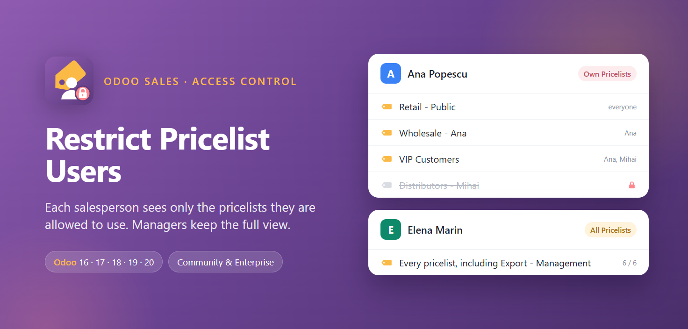
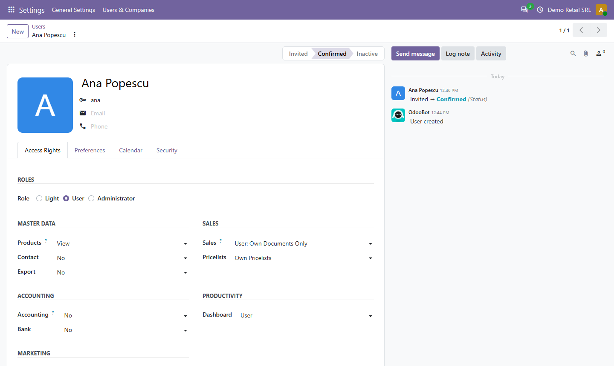
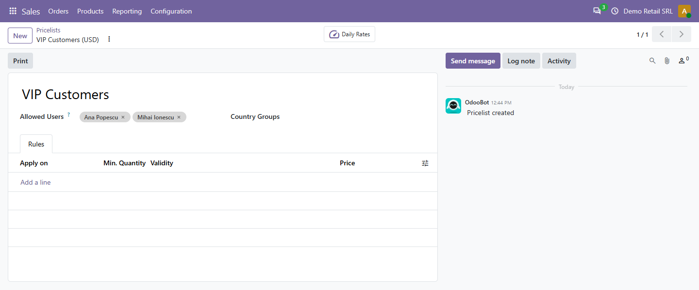
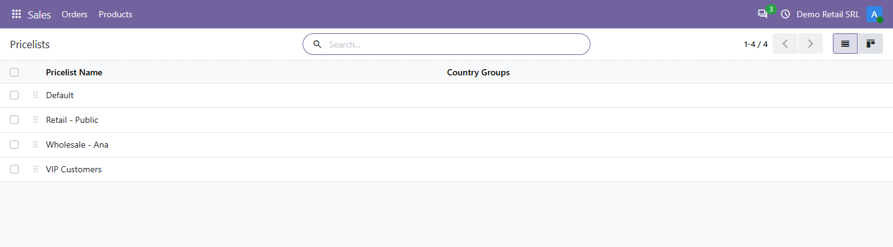
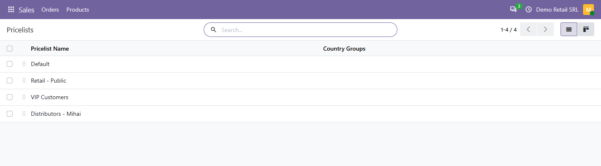
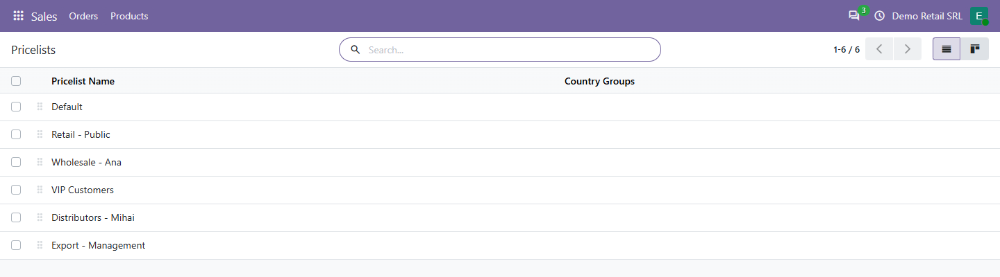

# Restrict Pricelist Users



Control **which salespeople can see which pricelists** in Odoo.

By default every internal user can see every pricelist in the database. That is often
not what you want: wholesale, distributor or VIP prices should only be visible to the
people who actually work with those customers. This module adds an **Allowed Users**
field on each pricelist and a pair of access groups, so you decide per pricelist and
per user who sees what. Restricted users only see their own pricelists in the
pricelist menu, on quotations, on customers and anywhere else a pricelist is selected.

- **Version:** 20.0 (also available for 16.0, 17.0, 18.0 and 19.0 on the matching branches)
- **Depends on:** `sale`
- **Editions:** Community and Enterprise
- **License:** OPL-1

## Features

- **Allowed Users** field on every pricelist, shown as tags on the pricelist form.
- Two access levels, grouped under **Sales → Pricelists** on the user form:
  - **Own Pricelists**: the user only sees pricelists where they are in *Allowed Users*,
    plus pricelists that have no *Allowed Users* at all (treated as public).
  - **All Pricelists**: the user sees every pricelist (for sales managers).
- Users with neither group keep the standard Odoo behaviour (they see all pricelists), so
  installing the module does not hide anything until you assign the groups.
- Group changes apply immediately, without logging out.

## Configuration

### 1. Enable pricelists

*Sales → Configuration → Settings → Pricing → Pricelists* (standard Odoo setting).

### 2. Give users an access level

*Settings → Users & Companies → Users*, open a user, tab **Access Rights**, section
**Sales**, field **Pricelists**:

- **Own Pricelists** for restricted salespeople;
- **All Pricelists** for managers who must see everything;
- leave it empty (*Not restricted*) to keep the standard behaviour.



### 3. Choose who can use each pricelist

*Sales → Products → Pricelists*, open a pricelist and fill **Allowed Users**.
Leave it empty to make the pricelist visible to everybody.



## Example

| Pricelist | Allowed Users |
|---|---|
| Default | *(empty: public)* |
| Retail - Public | *(empty: public)* |
| Wholesale - Ana | Ana Popescu |
| VIP Customers | Ana Popescu, Mihai Ionescu |
| Distributors - Mihai | Mihai Ionescu |
| Export - Management | Elena Marin |

Ana and Mihai have **Own Pricelists**, Elena has **All Pricelists**.

**Ana** sees the public pricelists, her wholesale pricelist and the shared VIP pricelist:



**Mihai** sees the public pricelists, his distributor pricelist and the shared VIP pricelist:



**Elena** (All Pricelists) sees everything, including pricelists assigned to other users:



## Technical notes

- Model: `models/product_pricelist.py` adds
  `allowed_users = fields.Many2many('res.users')` on `product.pricelist`.
- View: `views/product_pricelist_views.xml` inserts the field after `company_id` on the
  pricelist form.
- Security: `security/pricelist_rules.xml`
  - groups `group_view_own_pricelists` and `group_view_all_pricelists` (the latter implies
    the former) under the `res.groups.privilege` **Pricelists**, category Sales;
  - one `ir.access` record (Odoo 20 replaced `ir.rule` / `ir.model.access` with
    `ir.access`). Group permissions are OR-ed with the read permission every internal user
    already has on pricelists, so the filter is a global *restriction* on read whose domain
    depends on the user's groups:
    - user in *Own Pricelists* but not in *All Pricelists*:
      `['|', ('allowed_users', 'in', user.id), ('allowed_users', '=', False)]`
    - any other user: `[]` (no restriction).
- Only **read** access is restricted. Create, write and delete rights on pricelists still come
  from the standard Odoo groups (e.g. *Products: Administrator*).

## Tests

```bash
odoo-bin -d <test_db> --addons-path=<odoo>/addons,<path to this repo> \
    -i restrict_pricelist_users --test-enable \
    --test-tags /restrict_pricelist_users --stop-after-init
```

The suite (`tests/test_pricelist_access.py`) checks visibility for an allowed user, another
restricted user, an *All Pricelists* user, a user without groups, and an immediate group change.

## Demo

Video: <https://www.youtube.com/watch?v=2kjrHfIb4Dc>

## Support

Author: Banica Daniel. For support or customization requests, please contact the author.
